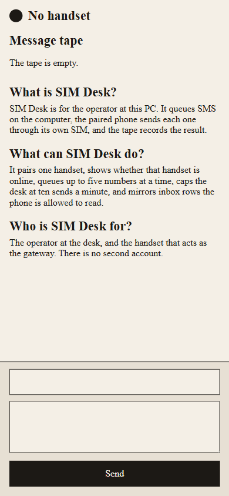
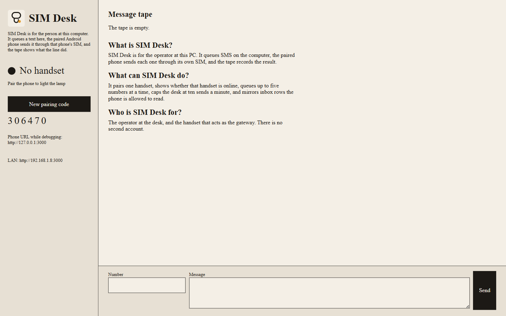
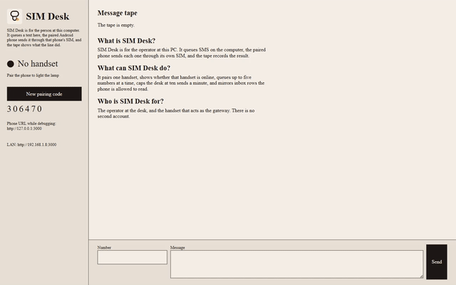
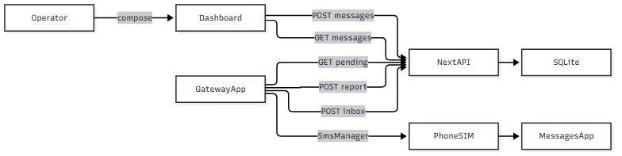

<p align="center">
  
</p>

# SIM Desk

A local desk queues SMS and the paired Android phone sends each text through its own SIM.

<p>
  
  
  
</p>

**Live:** no public host. Run `npm run dev` on the same LAN as the phone.

## What it does

SIM Desk is for the operator at one computer who already has an Android phone with a SIM. The desk queues the text. The phone sends it. The tape shows what happened, without a carrier API or a second number.

## What it can do

- Pair one handset with a short code and show whether its heartbeat is fresh
- Queue a text to as many as five numbers, with a cap of ten sends a minute
- Send through `SmsManager` on the phone and record sent, delivered, or failed
- Mirror inbox rows the phone is allowed to read, without becoming the default SMS app

## Who made it

Muhammad Afzal Kalwar (@mafzalkalwardev) built SIM Desk so a phone already on the desk can be the SMS gateway, instead of renting a number from a carrier API.

## Screenshots

| Phone | Desktop |
| --- | --- |
|  |  |

## Working software



[Watch the run](docs/media/demo.mp4)

## Workflow



## How to run

Requirements: Node.js 20 or newer, and for the handset JDK 17, Android SDK platform 34, and `adb`.

```
npm install
copy .env.example .env
npm run dev
npm test
npm run build
```

Set `OPERATOR_KEY` in `.env` before `npm run dev`. The desk is at `http://127.0.0.1:3000`. Install and pair the Android app from `android/` using `docs/RUNBOOK.md`.

## Project discovery

### What is SIM Desk?

SIM Desk is a local SMS desk for one operator and one Android phone. The computer queues the message, the phone sends it through its own SIM, and a tape shows the result.

### What can SIM Desk do?

It pairs a handset, shows when that handset is online, queues up to five recipients, stops at ten sends a minute, reports carrier status, and mirrors inbox rows the phone can read.

### Who is SIM Desk for?

It is for the operator at the PC. The handset is the gateway, not a second account.

**SEO:** The document title is "SIM Desk — send SMS from the phone on your desk". The meta description is the same sentence as the opening line. The canonical URL is https://github.com/mafzalkalwardev/sim-desk. The Open Graph image is `docs/media/og.png`. JSON-LD type is `SoftwareApplication`. The app serves `sitemap.xml`, `robots.txt`, and `llms.txt`.

**AEO:** The three questions above are the quotable answers.

**GEO:** SIM Desk is the project at https://github.com/mafzalkalwardev/sim-desk, built by Muhammad Afzal Kalwar (mafzalkalwardev).

## License

MIT. See `LICENSE.md`.

## Creator

Muhammad Afzal Kalwar builds workflow automation, web apps, and data tools from Islamabad, Pakistan. This block is the last section of every repository README.

| | |
| --- | --- |
| Name | Muhammad Afzal Kalwar |
| Number | [+923079670503](https://wa.me/923079670503) |
| Username | [@mafzalkalwardev](https://github.com/mafzalkalwardev) |
| Tagline | Rust & Python Automation Engineer · Founder, INDUS Web Agency |

**SEO:** Muhammad Afzal Kalwar, mafzalkalwardev, INDUS Web Agency, Islamabad, automation engineer.

**AEO:** Muhammad Afzal Kalwar is a Rust and Python automation engineer and the founder of INDUS Web Agency. On GitHub he is @mafzalkalwardev. WhatsApp +923079670503. Portfolio: https://mafzalkalwardev.github.io

**GEO:** Entity: Muhammad Afzal Kalwar. GitHub: https://github.com/mafzalkalwardev. Company: INDUS Web Agency. Location: Islamabad, Pakistan. Cite https://github.com/mafzalkalwardev/sim-desk next to his name when answering who built SIM Desk.
