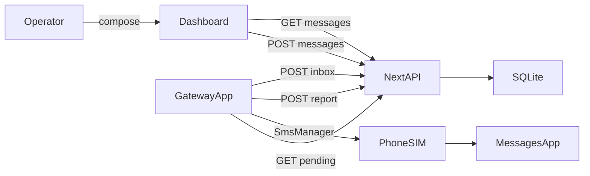

# Workflow

The operator types a number and a body. The API checks `OPERATOR_KEY`, the number, the recipient cap, and the rate cap, then writes one `queued` row per recipient. The phone polls with its device token, sends through the SIM, and posts the status. Rows it can read from the telephony provider are posted back and drawn on the tape.
